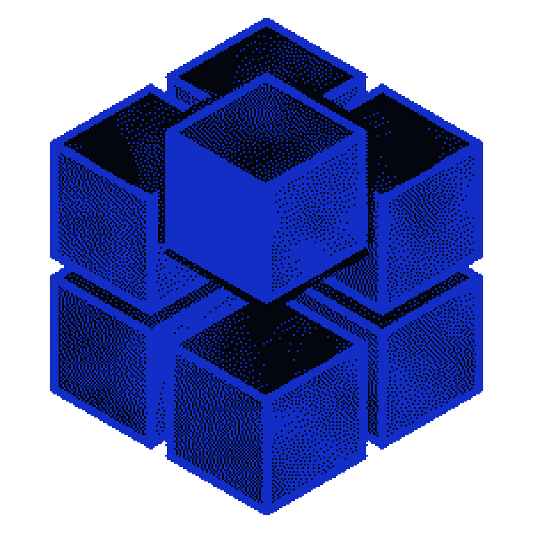

# Hypercube

**All your AI agents, in one cube.** Free and open source.

[🇧🇷 Português](README.md) · 🇺🇸 English



Hypercube is a desktop app for people who run several coding agents at once (Claude Code, Codex, Gemini, OpenCode...) and want to watch, direct and combine all of their work in one place.

> A tesseract is a hypercube. Each agent is an **agent**. **Hiper** (the cube mascot) rules them all.

**It's free to use. We only ask that you star the repo on GitHub!** ⭐

## What it does

- **Sessions**: every agent in one window, in real terminals, each with a live state (working, waiting for you, done, error) and a notification when something needs your answer.
- **Orchestration**: a **Leader** splits the task and creates agents with roles (Scout, Builder, Reviewer, Fixer). Each Builder works in its own copy of the project (a git worktree) and the result is reviewed before merging. It all shows up on a canvas.
- **Image canvas**: screens, images and drawings the agents produce appear live, side by side, so you can compare versions. Agents use the `canvas_adicionar_*` tools (or save to `.hypercube/saidas/`).
- **AI router**: a local server with free models (Groq, OpenCode, Kiro, Gemini) for mechanical tasks. Agents get a `consulta_barata` tool to summarize, classify and extract without spending your plan.
- **Safe by default**: everything runs on your machine, on `127.0.0.1` only, with a token on every call. The router never stores conversation content.

## Download and use

Get the installer from the [releases page](https://github.com/enzGL/hypercube/releases/latest) (Windows first; macOS and Linux later). You need at least one agent installed (for example Claude Code). The router needs [Node.js](https://nodejs.org).

The app interface is in Portuguese for now.

## Run from source

Needs Node 20+, stable Rust and [Tauri 2](https://tauri.app/start/prerequisites/).

```bash
cd app
npm install
npm run tauri:dev      # desktop app
npm run dev            # UI only, with simulated agents
```

## Folders

| Folder | What lives there |
|---|---|
| `app/` | Desktop app (Tauri 2 + React + TypeScript) |
| `router/` | AI router (Node, no dependencies) |
| `docs/` | Vision, roadmap, decisions |
| `design/` | Logo and the Hiper mascot |
| `site/` | Download page |

Start with [`docs/VISAO.md`](docs/VISAO.md) and follow the [`docs/ROADMAP.md`](docs/ROADMAP.md) (both in Portuguese).

A separate app from [TesserAct](https://github.com/enzGL/tesseract) (the management app). No paid plan.

## License

[MIT](LICENSE). The "Hypercube" name, the Hiper mascot and the logo are not part of the license.
