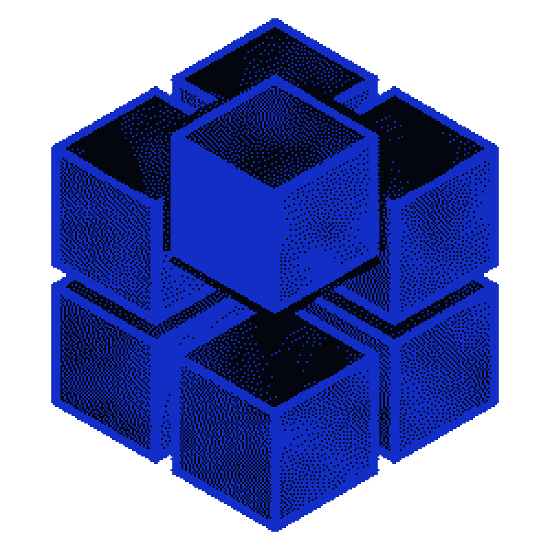
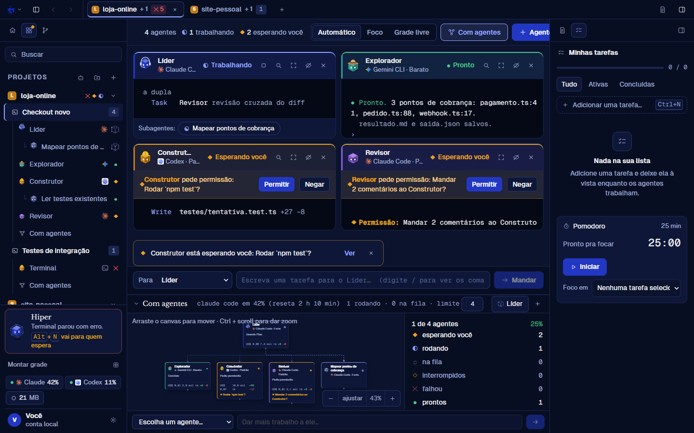
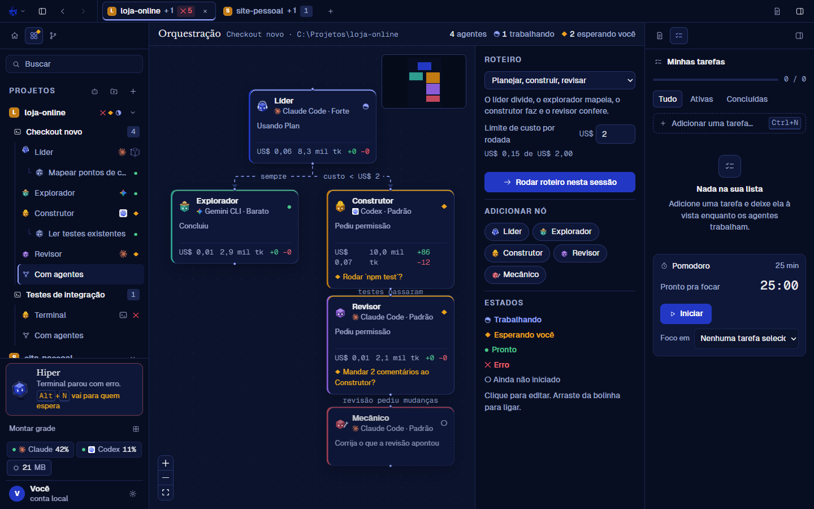
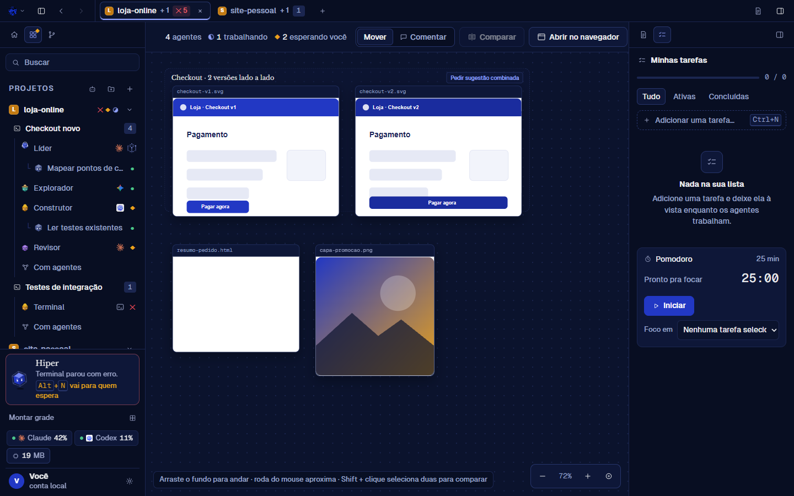
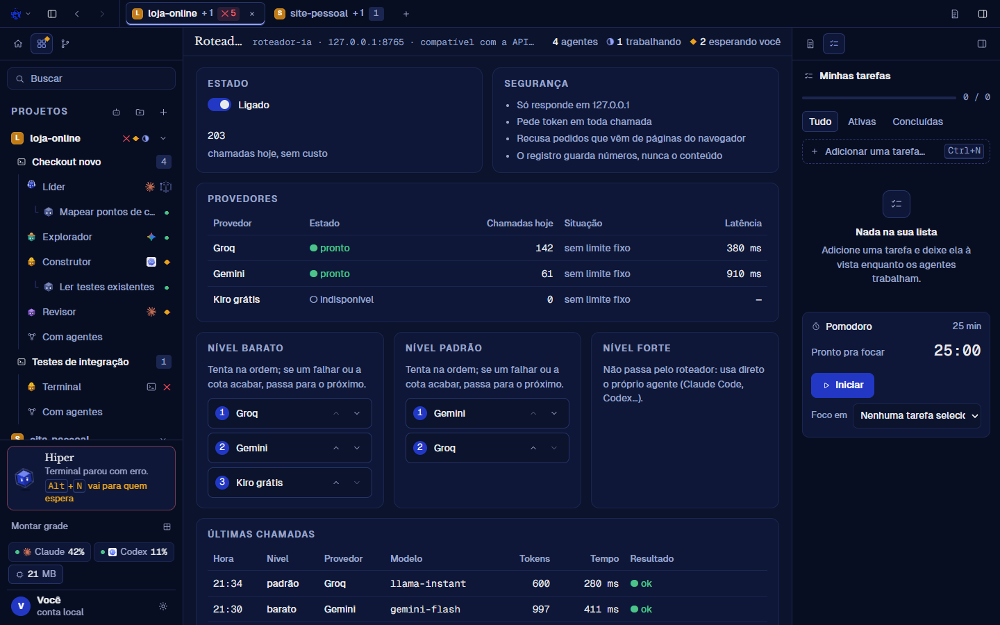

<div align="center">



# Hypercube

**Todos os seus agentes de IA, num cubo só.**

🇧🇷 Português · [🇺🇸 English](README.en.md)

[](LICENSE)
[](https://github.com/enzGL/hypercube/releases/latest)
[](https://github.com/enzGL/hypercube/stargazers)
[](https://github.com/enzGL/hypercube/issues)

[Baixar](https://github.com/enzGL/hypercube/releases/latest) · [Reportar problema](https://github.com/enzGL/hypercube/issues/new) · [Pedir recurso](https://github.com/enzGL/hypercube/issues/new) · [Contribuir](#contribuir)

</div>

> **Aviso:** o Hypercube está no começo (versão 0.x). A interface ainda é só em português e o instalador é só para Windows por enquanto. Ele é _local primeiro_: tudo roda na sua máquina, e nada sai dela sem você ligar.

**É grátis para usar. Só pedimos que você dê uma estrela no GitHub!** ⭐

<div align="center">



</div>

## O que é o Hypercube

O Hypercube é um app de desktop para quem trabalha com vários agentes de código ao mesmo tempo e quer ver, dirigir e juntar o trabalho de todos num lugar só. Em vez de dez janelas de terminal soltas, você tem uma janela com todos os agentes, o estado de cada um ao vivo e um aviso quando algum precisa da sua resposta.

> Um tesseract é um hipercubo. Cada agente é um **Vértice**. O **Hiper** (o cubo mascote) rege todos.

## Diferenciais

- **Todos os agentes, uma janela.** Claude Code, Codex, Gemini CLI, Kiro e OpenCode lado a lado, em terminais de verdade.
- **Estado ao vivo.** Você vê quem está trabalhando, quem espera a sua resposta e quem terminou, e pode permitir ou negar um pedido sem trocar de terminal.
- **Orquestração visual.** Um Líder reparte a tarefa, cada Construtor trabalha na sua própria cópia do projeto e o resultado é revisado antes de juntar.
- **Canvas de imagens ao vivo.** O que os agentes desenham aparece na hora, lado a lado, para comparar versões.
- **Roteador gratuito.** Tarefas mecânicas vão para modelos gratuitos e poupam o seu plano.
- **Local e privado.** Só `127.0.0.1`, sem conta e sem telemetria.

## Telas

| | |
|---|---|
| <br>**Sessões**: agentes, estados e pedidos de permissão | <br>**Orquestração**: Líder, papéis e roteiros no canvas |
| <br>**Imagens**: versões lado a lado, ao vivo | <br>**Roteador**: provedores gratuitos e cadeias por nível |

_Capturas no modo de exemplo, com agentes simulados._

## Plataformas

| Plataforma | Situação |
|---|---|
| Windows | Instalador e versão portátil |
| macOS | Depois |
| Linux | Depois |

## Agentes

O Hypercube abre os agentes que você já tem instalados, em terminais de verdade. Você instala e entra na conta de cada um do jeito de sempre.

| Agente | Estado ao vivo | Observação |
|---|---|---|
| Claude Code | Sim, por hooks | Principal; entende o orquestrador |
| Codex | Sim | Recebe as mesmas ferramentas do canvas |
| Gemini CLI | Terminal | |
| Kiro | Terminal | |
| OpenCode | Terminal | |
| Terminal comum | Terminal | Para qualquer outra coisa |

## O que ele faz

### Rodar agentes em paralelo

Todos os agentes numa janela, cada um com o estado ao vivo: trabalhando, esperando você, pronto ou com erro. Fechar a janela não mata o processo, e o histórico fica salvo para retomar depois.

### Orquestrar

Um **Líder** divide a tarefa e cria agentes com papéis: **Explorador**, **Construtor**, **Revisor** e **Mecânico**. Cada Construtor trabalha numa cópia própria do projeto (worktree), e o resultado é revisado antes de juntar. Tudo aparece num canvas de orquestração.

### Ver o que os agentes criam

Telas, imagens e desenhos que os agentes geram aparecem ao vivo no canvas de imagens, lado a lado, para você comparar versões. Os agentes usam as ferramentas `canvas_adicionar_imagem`, `canvas_adicionar_html` e `canvas_adicionar_svg` (ou salvam em `.hypercube/saidas/`).

### Gastar menos do seu plano

O **roteador de IA** é um servidor local com modelos gratuitos (Groq, OpenCode, Kiro, Gemini) para as tarefas mecânicas. Os agentes ganham a ferramenta `consulta_barata` para resumir, classificar e extrair sem gastar o seu plano.

### Ficar no controle

- Tudo roda só em `127.0.0.1`, com token em cada chamada.
- O roteador nunca guarda o conteúdo das conversas.
- Sem conta, sem telemetria, sem plano pago.

## Conceitos

| Termo | O que é |
|---|---|
| Sessão | Um conjunto de agentes trabalhando num mesmo projeto |
| Projeto | Uma pasta do seu computador |
| Vértice | Um agente rodando num terminal real |
| Líder | O Vértice que divide a tarefa e cria os outros |
| Papel | Explorador, Construtor, Revisor ou Mecânico |
| Hiper | O cubo mascote; muda conforme o estado das sessões |

## Filosofia

- **Grátis e aberto.** Sem plano pago, sem login.
- **Simples primeiro.** Uma coisa por vez, cada uma testada no app antes da próxima.
- **Seu computador manda.** Nada vai para a nuvem; a única saída é a que você ligar.
- **Código nosso.** De fora entram só bibliotecas instaladas por npm ou cargo.

## Instalar

Baixe o instalador na [página de versões](https://github.com/enzGL/hypercube/releases/latest) (Windows primeiro). Você precisa ter pelo menos um agente instalado (por exemplo o Claude Code). O roteador precisa do [Node.js](https://nodejs.org).

> O instalador do Windows ainda não é assinado, então o SmartScreen pode avisar na primeira vez. Clique em "Mais informações" e depois em "Executar assim mesmo".

## Rodar a partir do código

Precisa de Node 20+, Rust estável e o [Tauri 2](https://tauri.app/start/prerequisites/).

```bash
cd app
npm install
npm run tauri:dev      # app de desktop
npm run dev            # só a interface, com agentes simulados
npm run tauri:build    # gera o instalador
```

| Pasta | O que vai ali |
|---|---|
| `app/` | App desktop (Tauri 2 + React + TypeScript) |
| `router/` | Roteador de IA (Node, sem dependências) |
| `canvas/` | Página do canvas no navegador |
| `docs/` | Visão, roadmap, decisões |
| `design/` | Logo e o mascote Hiper |
| `site/` | Página de download |

## Roadmap

- [x] **0.1 Núcleo**: terminais reais, Claude Code e Codex, estado ao vivo, avisos
- [x] **0.2 Orquestração**: worktrees, Líder e Vértices, canvas de orquestração
- [x] **0.3 Imagens e roteador**: canvas de imagens ao vivo, ferramentas MCP, roteador dentro
- [ ] **0.4 Lançamento**: README em PT/EN, página de download, instalador publicado
- [ ] Celular por QR, aba de MCP e Skills, passar a conversa entre agentes
- [ ] Comunidade: vitrine de projetos, perfis, selos e loja de agentes

Detalhes em [`docs/ROADMAP.md`](docs/ROADMAP.md). Para entender a ideia, comece por [`docs/VISAO.md`](docs/VISAO.md).

## Contribuir

Contribuições são bem-vindas. Abra uma [issue](https://github.com/enzGL/hypercube/issues) para conversar antes de mudanças grandes, e leia [`docs/DECISOES.md`](docs/DECISOES.md) para saber o que já foi decidido. Um pull request por assunto, testado no app.

## Licença

[MIT](LICENSE). O nome "Hypercube", o mascote Hiper e a logo não fazem parte da licença.

## Comunidade

- [Issues](https://github.com/enzGL/hypercube/issues): dúvidas, problemas e ideias
- [Estrelas](https://github.com/enzGL/hypercube/stargazers): o jeito mais fácil de ajudar
- Mantido por [Enzo (enzGL)](https://github.com/enzGL), da [Lanzi Labs](https://lanzilabs.dev)
- App separado do [TesserAct](https://github.com/enzGL/tesseract) (o app de gestão)
